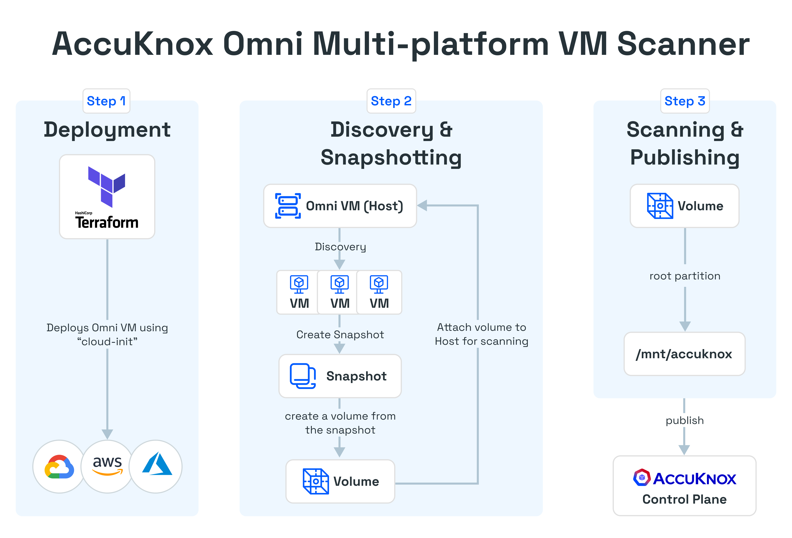

# Agent-less Installation



Agent-less VM scanning is supported for AWS, GCP, Azure, and Openshift.
Support for OCI and Nutanix is planned.

## Public Clouds - AWS, GCP, Azure

This guide assumes that Terraform and the respective cloud provider CLI are
installed. You should have received the Terraform code from AccuKnox.

```
terraform/
├── aws
│   ├── cloud-init.yaml -> ../cloud-init.yaml
│   ├── main.tf
│   ├── otel-collector-config.yaml -> ../otel-collector-config.yaml
│   ├── provider.tf
│   ├── terraform.tfvars.example
│   └── variables.tf
├── azure
│   ├── cloud-init.yaml -> ../cloud-init.yaml
│   ├── main.tf
│   ├── otel-collector-config.yaml -> ../otel-collector-config.yaml
│   ├── provider.tf
│   ├── terraform.tfvars.example
│   └── variables.tf
├── cloud-init.yaml
├── gcp
│   ├── cloud-init.yaml -> ../cloud-init.yaml
│   ├── main.tf
│   ├── otel-collector-config.yaml -> ../otel-collector-config.yaml
│   ├── provider.tf
│   ├── terraform.tfvars.example
│   └── variables.tf
└── otel-collector-config.yaml
```

Each cloud provider directory includes a `terraform.tfvars.example` file.
Update the file according to your requirements and save it as
`terraform.tfvars`.

E.g.,

```
cd aws
cp terraform.tfvars.example terraform.tfvars
```

- Artifact API tokens can be created under Settings -> Tokens.
- Labels can be created under Settings -> Labels.

After configuration, run `terraform apply` to provision the required
infrastructure in the corresponding cloud account.

E.g.,

```
terraform apply
```
